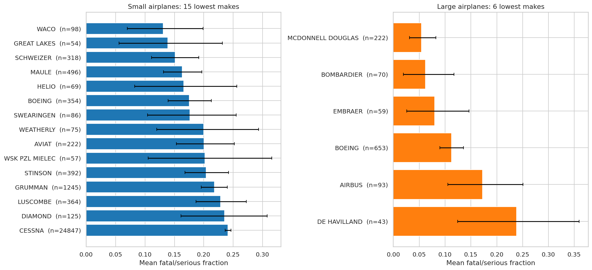
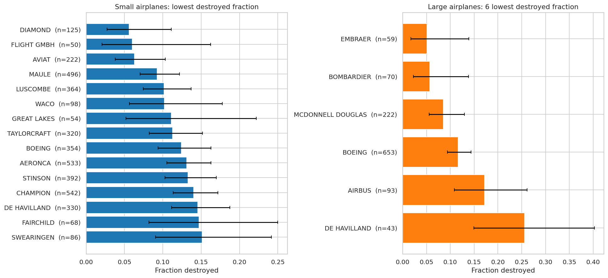
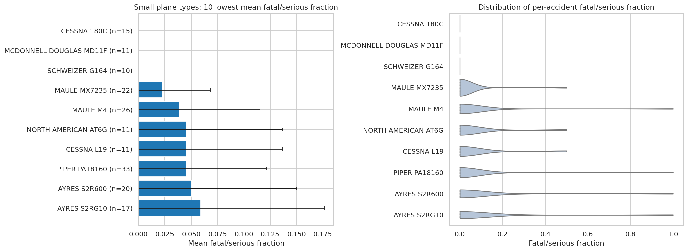
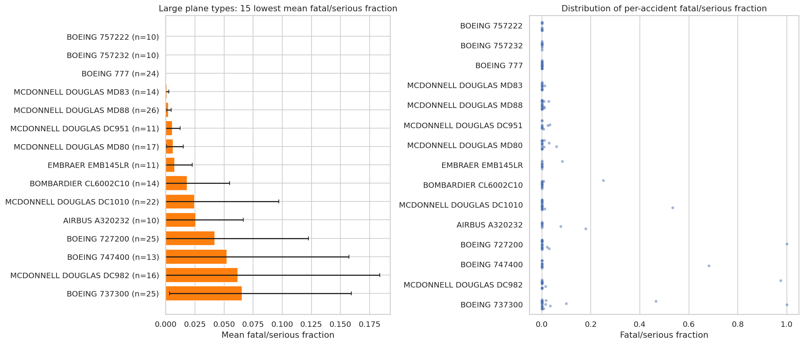
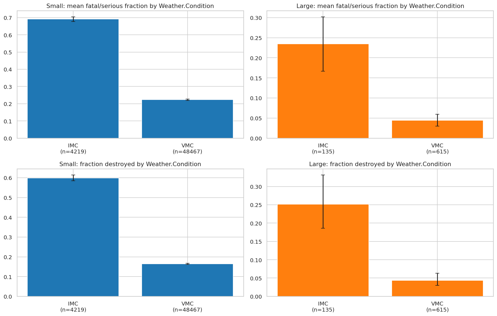
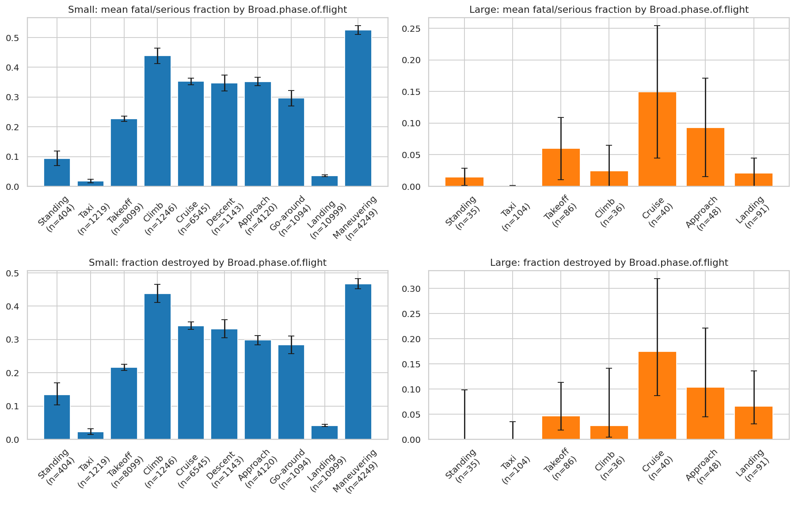

# Aviation Accident Safety Analysis (1983-2022 airplane accidents)

**Client:** an airline / airplane insurer. **Question:** which professionally built airplane makes/models show low rates of destruction and low likelihood of fatal or serious injury in an accident, and what general conditions matter? Separate recommendations for **small** (<20 people aboard) and **large** aircraft.

## Repository
| File | Purpose |
|---|---|
| `Aviation_Accidents_Cleaning.ipynb` | Load, inspect, clean; builds the key metrics; writes `data/cleaned_aviation.csv` |
| `Aviation_Accidents_Data_Analysis.ipynb` | EDA, make/model rankings, factor analysis, statistical tests |
| `data/AviationData.csv` | Raw data (NTSB-style records 1948-2023) |
| `data/cleaned_aviation.csv` | Output of the cleaning notebook |
| `images/` | Figures used below |

Run order: Cleaning notebook, then Analysis notebook (run both from the repo root). Requires pandas, numpy, matplotlib, seaborn, scipy.

## Method in brief
- **Filters (client brief):** airplanes only, professionally built only (`Amateur.Built == No`), events from 1983 on (40-year assumed service life). Missing `Aircraft.Category` was recovered from other records of the same make/model.
- **Fatal/serious fraction** = (fatal + serious injuries) / persons aboard, per accident. **Destroyed** = aircraft damage is `Destroyed`.
- **Makes** standardised (case, punctuation, corporate suffixes, known variants merged) and kept only with 50+ records. **Plane type** = make + normalised model, because model labels repeat across makes.
- **Small vs. large:** a plane type is *Large* if at least 25% of its accidents had 20+ people aboard (robust to one mis-keyed record). 54,656 small and 1,142 large records.
- **Robustness:** minimum sample sizes (50 per make, 10 per type to plot, 30 small / 20 large for shortlists, 30 per factor level), 95% confidence intervals on every mean/proportion, Kruskal-Wallis, Mann-Whitney, Welch and chi-square tests with Bonferroni correction.

> **Limitation:** the data are accidents only (no flight hours), so results describe *severity given an accident*, not accident frequency.

## Key results

### Makes: injury fraction (95% CI)

### Makes: destruction rate

### Recommendations
**Small aircraft**
- **Maule**: top 5 on both injury (0.163) and destruction (9.3%), n=496, significantly better than Cessna (0.241).
- **Aviat, Diamond**: lowest destruction (about 6%), average injury outcomes.
- **Waco, Schweizer**: significantly lower injury, but niche/special-use types.
- Best-evidenced types (n >= 30): **Piper PA-18 Super Cub, Piper PA-20, Cessna 180/185 family**.
- Caution: agricultural types (Grumman G-164A, Ayres S2R) have low injury but 18-23% destruction.

**Large aircraft**
- **McDonnell Douglas** (0.054) is significantly lower than Boeing (0.113); many types are older, confirm they are still active.
- **Bombardier and Embraer** regional jets: low injury and destruction (5-8%), smaller samples so moderate confidence.
- **Boeing** (777, 757, 737/727 variants): best-evidenced (n=653), 11.6% destroyed.
- **Airbus** (0.172) and **De Havilland** (0.238) look worse here, with limited evidence (n=93, 43; not significant after correction).

### General factors
**1. Weather.** IMC accidents are far more severe: small 0.691 vs 0.223 fatal/serious fraction, large 0.234 vs 0.045; destroyed 59.9% vs 16.5% (small) and 25.2% vs 4.4% (large). All p < 1e-13.

**2. Phase of flight.** Maneuvering, climb and cruise are the most severe; landing (0.035) and taxi (0.017) are mild for small aircraft; the same pattern holds for large aircraft with smaller samples.

**3. Number of engines (small aircraft only).** Twins are worse than singles (0.357 vs 0.250), but this reverses in IMC. No effect for large aircraft (p = 0.87). **4. Engine type:** turbojet small aircraft worst (0.402).

See the Data Analysis notebook for all tables, tests and discussion.
